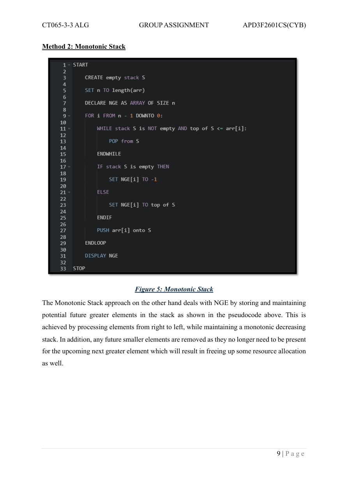
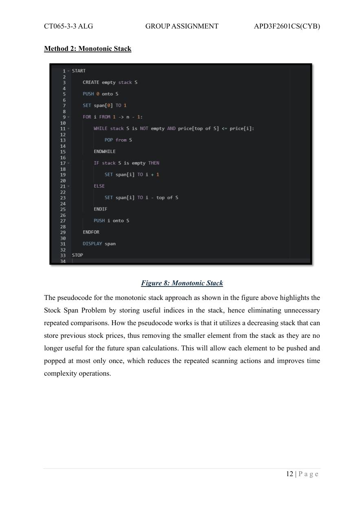
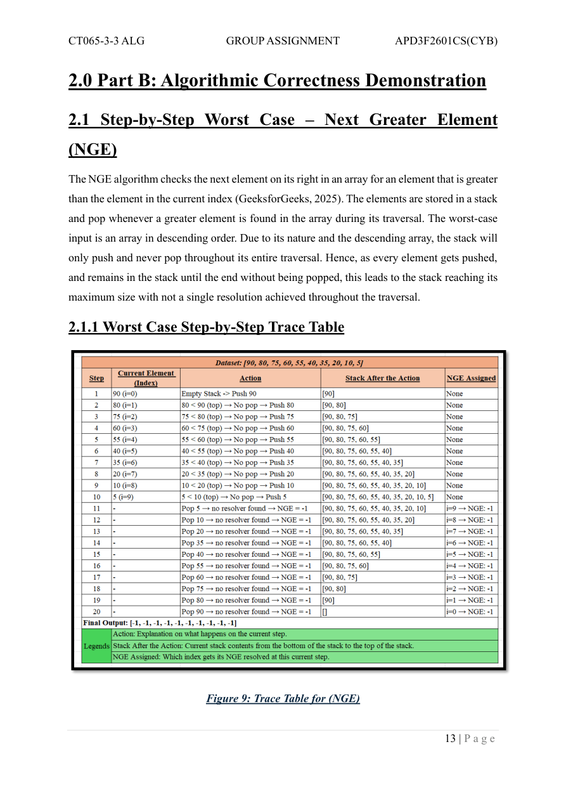
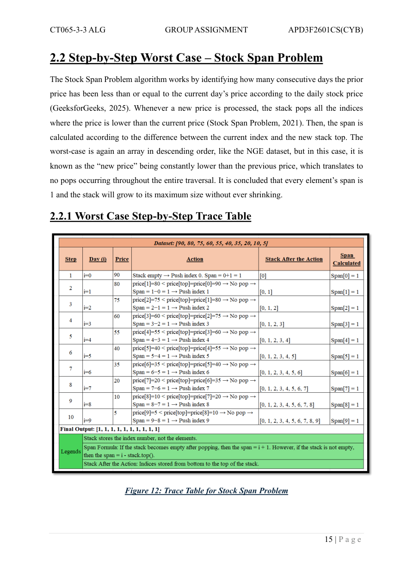
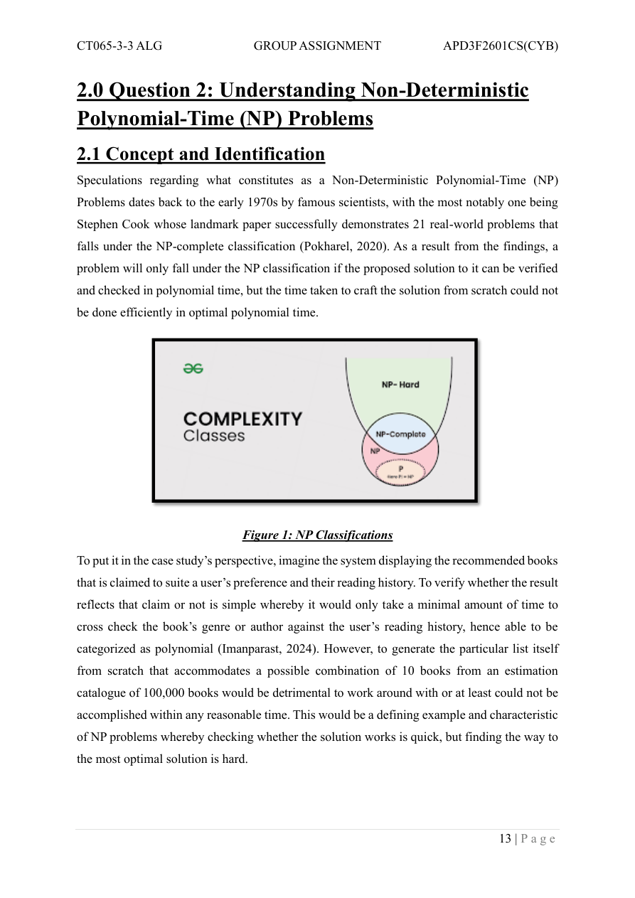
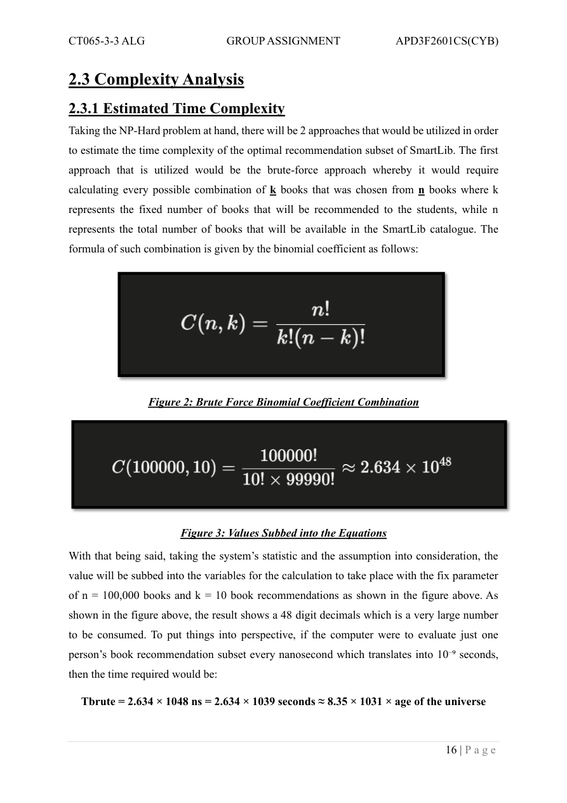

# Algorithmic Complexity & Optimization

### Data Structures, Monotonic Stacks, P vs NP, and Real-World Algorithm Selection

**Academic portfolio | Algorithmics (CT065-3-3 ALG) | Asia Pacific University, Malaysia | 2026**

A two-part **group academic assignment** exploring how algorithm design, correctness, and computational complexity influence efficient software systems. The project combines hands-on algorithm tracing and pseudocode analysis with a case study of a university smart-library platform.

> **Project scope:** This repository presents documented algorithm analysis, pseudocode, trace tables, comparisons, and optimization proposals from the original academic reports. It does not claim to contain a deployable SmartLib application or independently verified executable implementations.

## Repository contents

| File | Contents |
| --- | --- |
| [Algorithmics-Part-1.pdf](Algorithmics-Part-1.pdf) | Stack fundamentals, Next Greater Element, Stock Span, correctness, complexity, and comparisons |
| [Algorithmics-Part-2.pdf](Algorithmics-Part-2.pdf) | P and NP concepts, SmartLib search and recommendation operations, scalability, heuristics, and caching |
| `*.png` | Selected page visuals from the original reports |

## Part 1 — Data structures and algorithmic analysis

**Focus:** Compare straightforward iterative methods with **monotonic stack** techniques for two classical problems.

- **Stack fundamentals:** LIFO behavior, push/pop/top, array and linked-list representations, and trade-offs.
- **Next Greater Element (NGE):** Identify the first strictly greater element to the right of each array element; compare a naive forward scan with a monotonic stack.
- **Stock Span:** Calculate the number of consecutive preceding days with prices less than or equal to the current price; compare a naive backward scan with a monotonic stack.
- **Correctness:** Step-by-step trace tables, empirical checks, and loop-invariant discussion.
- **Complexity:** Contrast the naive approaches' potential **O(n²)** behavior with **O(n)** monotonic-stack solutions, using **O(n)** auxiliary stack space.

### Next Greater Element — monotonic stack

### Stock Span — monotonic stack

### Correctness evidence

| Next Greater Element trace | Stock Span trace |
| --- | --- |
|  |  |

## Part 2 — Computational complexity in SmartLib

**Case study:** A hypothetical university library managing **100,000 books**, with a **2-second search response target**, approximately **2,000 daily searches**, and daily borrowing and return activity.

### Efficient operations (P)

| Operation | Proposed structure | Discussed time complexity |
| --- | --- | --- |
| ISBN book search | Hash table | O(1) average |
| Title/author indexed lookup | Balanced search tree | O(log n) |
| Book availability lookup | Hash map / indexed record | O(1) average or O(log n) |

### Recommendation optimization

The report investigates the difficulty of choosing a best set of **10 recommended books** from a large catalogue when additional joint constraints or scoring requirements apply. It contrasts exhaustive combinatorial search with practical heuristic selection, and discusses **precomputation and caching** to improve response times.

**Complexity-class illustration from the report:**

**Combinatorial selection analysis from the report:**

> **Technical distinction:** Selecting the 10 highest independently scored books is polynomial-time. An NP-hard formulation requires an explicitly defined combinatorial objective or constraints; the report discusses assumptions for such a formulation. A large number of candidate subsets alone does not prove NP-hardness.

## Key takeaways

1. **Algorithm choice matters:** Monotonic stacks avoid repeated scans for NGE and Stock Span.
2. **Correctness matters:** Trace tables and invariants help explain why an algorithm produces the expected result.
3. **Complexity matters:** Asymptotic analysis supports scalable choices before deployment.
4. **Requirements matter:** Real-time search favors predictable indexed lookups; complex recommendations may benefit from heuristics and cached results.

## Academic attribution

This repository documents a **group assignment** submitted for the Algorithmics module at **Asia Pacific University of Technology & Innovation (APU)** in 2026. **Fairouz Abdulrahman Hamed Mousa Abdelmaguid** is listed among the group members in both original reports. The full reports preserve the original group attribution, references, and appendices. No individual contribution breakdown is asserted here.

## Notes

- Images are extracted page previews of figures and analysis from the submitted PDFs, not newly generated experimental evidence.
- The PDFs contain academic citations and the full discussion; consult them for the complete methodology and references.
- This repository is an educational case study and documentation portfolio, not a production software package.
